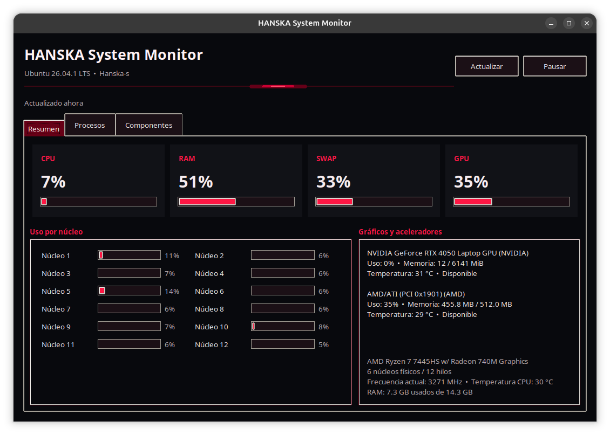
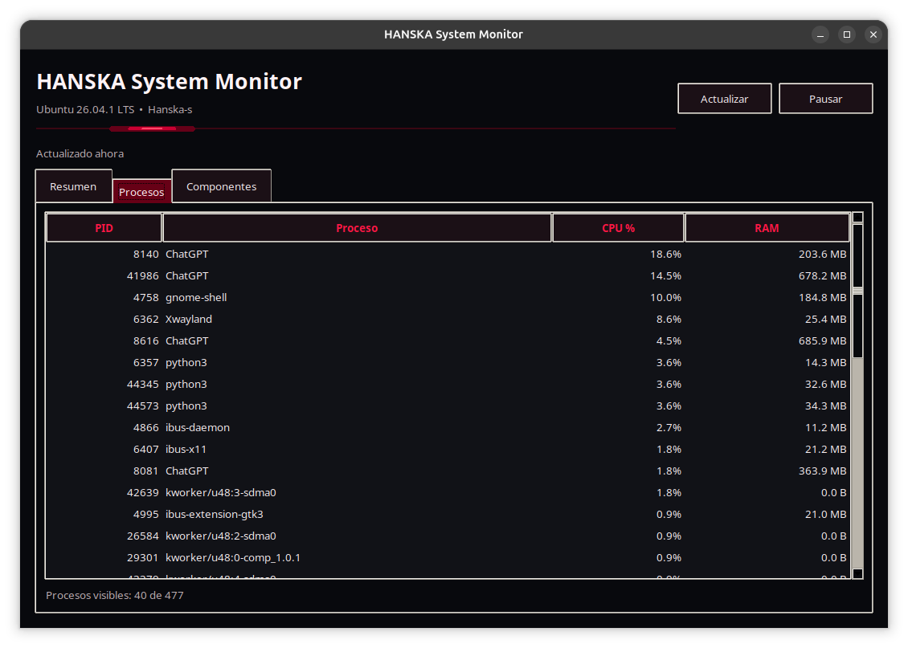
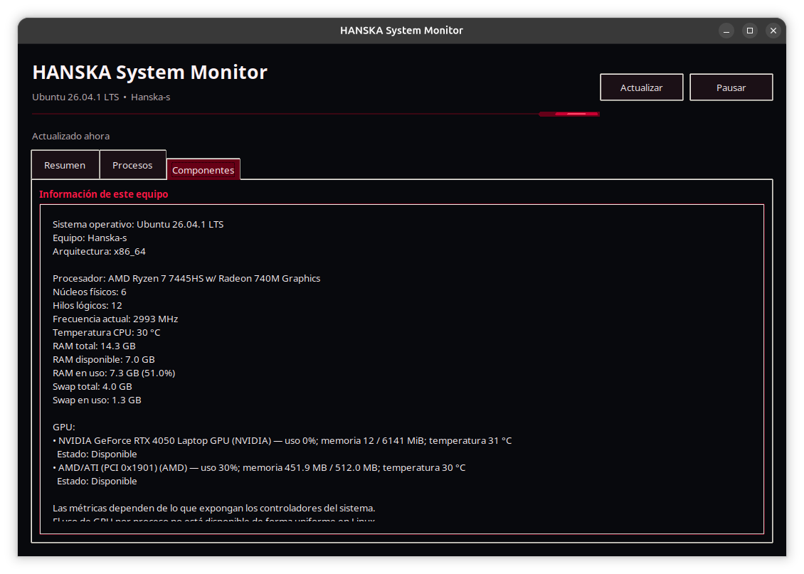

# HANSKA System Monitor

## Screenshots








## Screenshots


A lightweight desktop monitor for Ubuntu and Linux. It provides a Spanish-language Tkinter interface for local CPU, memory, process, temperature, and available GPU readings.

## Features

- CPU usage (total and per core), model, frequency, and temperature when exposed by the system.
- RAM and swap usage.
- A sortable list of up to 40 processes with CPU and memory use.
- NVIDIA metrics through `nvidia-smi` and available AMD metrics from `/sys/class/drm`.
- Refresh every two seconds, with pause, resume, and manual refresh controls.

GPU metrics depend on the installed driver and hardware interfaces. NVIDIA readings require a working driver and `nvidia-smi`. Linux does not provide a consistent way to attribute GPU use to individual processes; the process list reports CPU and memory only. The application reads local system data and does not require administrator privileges.

## Requirements

- Python 3
- Tkinter
- `psutil`
- Optional: `nvidia-smi` for NVIDIA GPU metrics; `lspci` for device detection when metrics are unavailable.

On Ubuntu, install the runtime dependencies with:

```bash
sudo apt install python3 python3-tk python3-psutil
```

## Run from source

```bash
python3 monitor.py
```

The Debian package installs the launcher at `/usr/bin/hanska-system-monitor` and the application under `/usr/lib/hanska-system-monitor/`.

## Project status

Version 1.0.0. The application is designed for Ubuntu/Linux desktops. Available metrics vary by kernel, hardware, and driver.

## License

No open-source license is granted. All rights reserved by the copyright holder.
